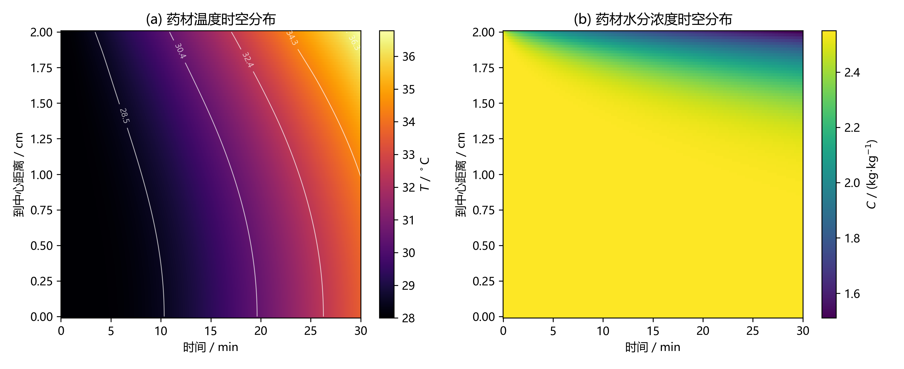
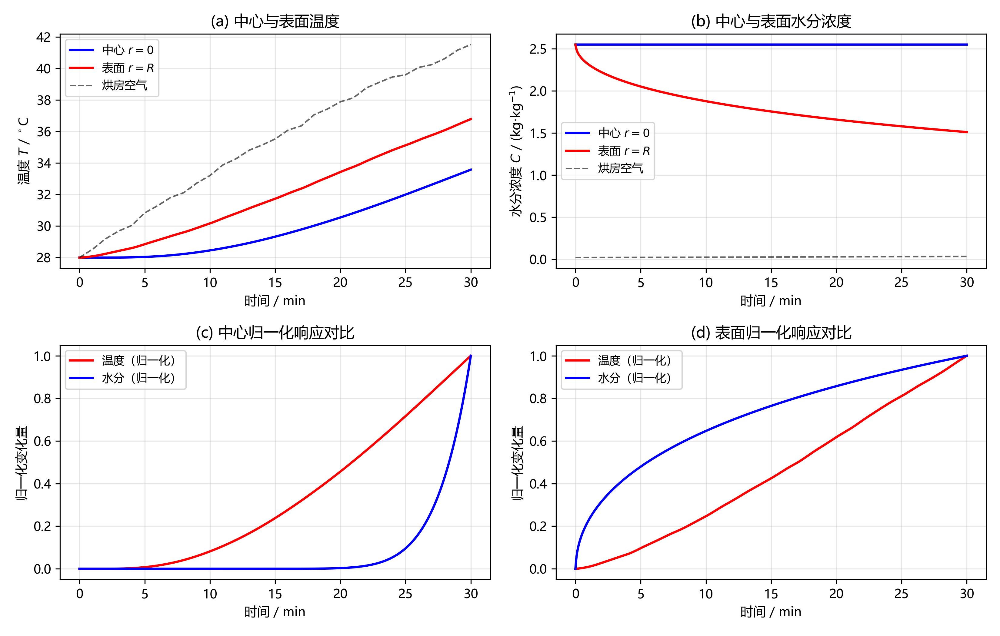
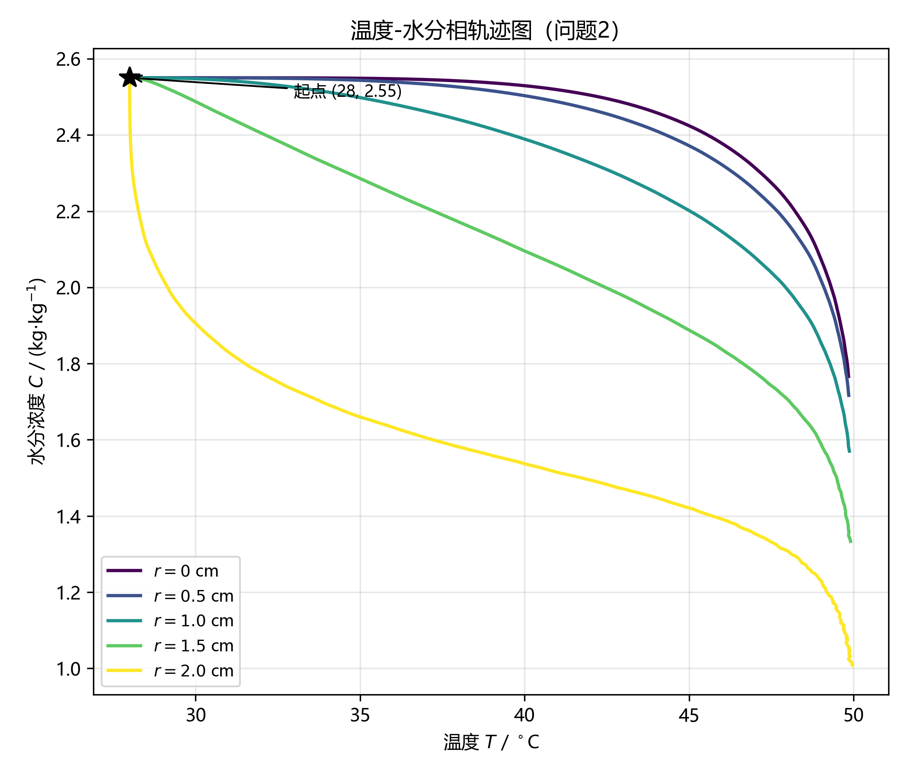
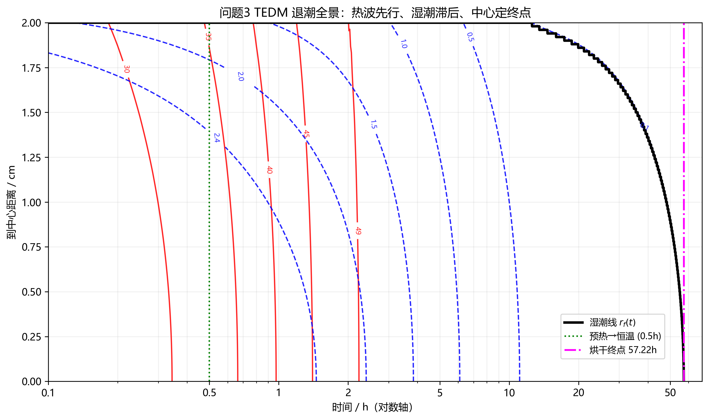
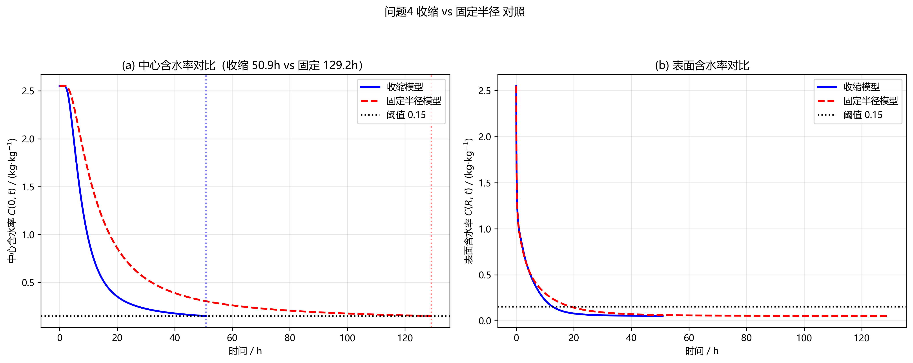
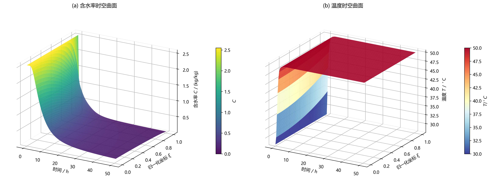

# TEDM · 退潮烘干模型

> **T**ide-**E**bbing **D**rying **M**odel — 2026 高教社杯全国大学生数学建模竞赛
> A 题「药材的烘干」的完整可复现计算代码。

[English below](#english)

---

## 这是什么 / What is this

这是一份**从完整参赛论文整理而来的开源复现仓库**。原论文因未在截止前
上传而未能参赛，但其计算工作本身已达到较高的工程完整度。我们把原始
`src/` 重构成可安装、可测试的 Python 包，并**补充了论文里没有的验证
与确认（V&V）模块**，以便作为作品集公开。

统一建模框架叫 **TEDM（退潮模型）**，口诀：

> **热波先行 · 湿潮滞后 · 中心定终点 · 收缩改尺度**

---

## 核心结果（代码可复现 / reproducible）

| 问题 | 关键输出 |
|------|----------|
| **Q1** | 30 min：中心 `33.5765 ℃` / 表面 `36.7863 ℃`；表面水分 `1.5104 kg/kg` |
| **Q2** | 3 h（变物性 + Arrhenius）：中心/表面温度 `49.8494 / 49.9664 ℃`；水分 `1.7662 / 1.0081` |
| **Q3** | 50 ℃ 干燥到 `C<0.15`：**τ = `57.2234 h`**，终点中心 `C = 0.1500` |
| **Q4** | 收缩 `R: 2.00→1.20 cm`：**τ = `50.8651 h`**；定半径对照 `129.1500 h`（**快 60.6 %**）|

所有数字与论文原文逐位一致。

---

## 验证与确认（这是本仓库的亮点）/ V&V highlights

| 类别 | 证据 | 结果 |
|------|------|------|
| **解析解对比** | Bessel 级数（J₀/J₁，Robin 特征值） | 水分相对 L2 `5.65e-05`，温度 `1.02e-04` |
| **观测收敛阶** | 空间 ≈2 阶、时间（后向欧拉）≈1 阶 | 与理论吻合 |
| **离散守恒** | FVM 守恒通量 | 能量残差 `1.59e-13`，水分 `6.39e-15` |
| **极值原理** | `C` 不超过初值、表面单调变干 | 满足 |
| **QoI 收敛** | 四题关注量网格/步长极差 | 全部 < 0.6 % |
| **不确定性** | 蒙特卡洛 | 干燥时间均值 `59.70 h`，P95 `77.32 h` |
| **参数权衡** | 时间–能耗 Pareto | 40/50/70 ℃ 三档工艺对比 |

详见 [`docs/verification.md`](docs/verification.md)。

---

## 诚实的局限 / Honest limitations

我们**主动、定量**地报告了模型的边界（这是科学诚实，不是减分项）：

- **问题4 干物质漂移 `−10.97 %`**：收缩模型里干物质密度前后不一致
  （`ρ_d` 由状态反推 278.73 → 689.34，而方程(13) 给 774.26），源于论文
  承认的「均匀收缩假设」。详见 [`docs/limitations.md`](docs/limitations.md)。
- 一度尝试的 half-cell 表面格式**实测更差**（`7.85e-05 → 9.86e-04`），
  已回退并记录了原因。
- 一维径向简化、降速段经验式等简化假设，已在文档与论文 9.2 节说明。

---

## 仓库结构 / Layout

```
tedm/            # 可安装 Python 包（重构成 tedm.* 命名空间）
  model.py solver*.py properties.py config.py data_loader.py
  analysis/       # 验证 / 守恒 / 收敛 / 灵敏度 / 不确定性 / Pareto
  viz/q1..q4.py   # 32 张图
  postprocess*.py # result1..4.xlsx 与 表1..表6.xlsx
figures/          # 32 张图（直接提交，无需 Git LFS）
data/             # 附件1/2.xlsx 与 6 张结果表
docs/             # model / verification / limitations / award-assessment / paper-summary
tests/            # pytest 套件（133 项，全绿）
scripts/run_all.py # 一键复现全部产物
```

---

## 快速开始 / Quick start

```bash
# 1. 依赖（需要 numpy / scipy / pandas / matplotlib / openpyxl）
pip install -r requirements.txt

# 2. 一键复现全部结果、表格、图表与 V&V 报告
python scripts/run_all.py
#   产物落在 output/：result1..4.xlsx、tables/*.xlsx、figures/*.png、
#   conservation_report.txt、verification_report.txt、convergence_report.txt

# 3. 只跑测试
pytest                # 133 项，约 60 s（含慢速科学验证）
pytest -m "not slow"  # 仅快速测试，约 10 s

# 4. 单独画某题的图
python -m tedm.viz.q3
```

> 注：`figures/` 下的 32 张图已直接提交（约 8 MB，无需 Git LFS）。

---

## 图表画廊（节选）/ Figure gallery

| 图 | 说明 |
|----|------|
|  | Q1 温度/水分时空演化 |
|  | Q1 中心/表面时程 |
|  | Q2 温度–水分相轨迹 |
|  | Q3 TEDM 退潮全景 |
|  | Q4 收缩 vs 定半径 |
|  | Q4 移动边界 3D |

完整 32 张见 [`figures/`](figures/)。

---

## 文档 / Docs

- [模型说明](docs/model.md) · [验证与确认](docs/verification.md)
- [已知局限](docs/limitations.md) · [论文评阅](docs/paper-summary.md)
- [投稿能拿什么奖？](docs/award-assessment.md)

---

## 许可证与引用 / License & citation

[MIT](LICENSE)。若用于研究，请引用 [`CITATION.cff`](CITATION.cff)。

---

## English

**TEDM — Tide-Ebbing Drying Model** is the fully reproducible computational
code for the 2026 CUMCM (China Undergraduate Mathematical Contest in Modeling)
Problem A, *"Herb Drying"*. The original paper was not uploaded before the
deadline, but the computational work is solid; this repo refactors the code
into an installable, tested Python package and **adds the verification &
validation (V&V) modules the paper lacked**.

A unifying framework — **TEDM** ("heat wave leads, moisture tide ebbs, the
centre sets the endpoint, shrinkage rescales") — carries all four sub-problems.

Headline, bit-exact reproducible results: Q1 centre/surface `33.5765 / 36.7863
℃`; Q3 drying time `τ = 57.2234 h`; Q4 `τ = 50.8651 h` (60.6 % faster than the
fixed-radius control).

V&V evidence: comparison against the analytical Bessel series (relative L2
`5.65e-05` moisture, `1.02e-04` temperature); observed spatial order ≈2 and
temporal order ≈1; discrete-conservation residuals `1.59e-13` (energy) and
`6.39e-15` (moisture); Monte-Carlo uncertainty (mean `59.70 h`, P95 `77.32 h`);
a time–energy Pareto frontier.

We **honestly disclose** a `−10.97 %` dry-matter drift in the Q4 moving-boundary
model (a documented modelling approximation, not a numerics bug) — see
[`docs/limitations.md`](docs/limitations.md).

```bash
pip install -r requirements.txt
python scripts/run_all.py     # reproduce everything
pytest                        # 133 tests
```

Licensed under [MIT](LICENSE). Cite via [`CITATION.cff`](CITATION.cff).
